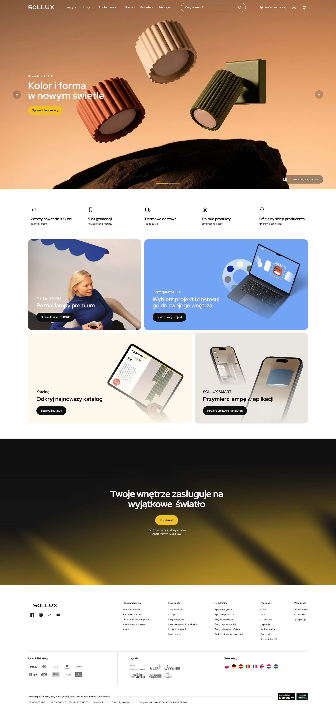

# SOLLUX landing page (IdoMods recruitment task)

A landing page built from the Figma file *IdoMods rekrutacja frontend AI*.
The stack is React, TypeScript, Vite and plain CSS with CSS variables, with no UI or animation libraries.

**Live demo:** https://idomods-landingpage.vercel.app



## Getting started

You need Node.js 20 or newer (it was developed on Node 22).

```bash
npm install
npm run dev       # dev server on http://localhost:5173
npm run build     # type-check (tsc) and production build into dist/
npm run preview   # serve the production build locally
npm run lint      # oxlint
```

There is no unit-test suite: the page has almost no logic to unit-test. The interactions, layout and console were checked in a real browser with Playwright during development (see `docs/AI_WORKFLOW.md`).

The `dist/` folder is a static site, so it can be hosted anywhere. The live demo is deployed on Vercel with the Vercel CLI (`vercel deploy --prod`), using the detected Vite settings (build command `vite build`, output directory `dist`).

## Project structure

```
src/
  main.tsx                 entry: fonts, global CSS, <App />
  App.tsx                  page sections in Figma order
  styles/
    variables.css          design tokens: colours, type scale, spacing, easing, durations
    base.css               reset + shared pieces (.container, .btn, .circle-btn, .icon)
  components/
    Icon/                  single-colour SVG drawn with CSS mask (inherits currentColor)
    Header/                fixed header, dropdowns, search, mobile slide-in menu
    Hero/                  slider (Hero.tsx) + interactive lamp scene (LampScene.tsx)
    Showcase/              white section that holds ValueProps + Tiles
    ValueProps/            5 store benefits
    Tiles/                 2×2 promo grid
    ShaderBanner/          WebGL light animation (lightShader.ts) + static copy
    Footer/                links, payments, awards, stores, legal caption
  data/                    navigation and footer content kept out of the JSX
  hooks/                   useInView, usePageVisible, usePrefersReducedMotion
  assets/                  everything exported from Figma (see "Assets" below)
docs/
  AI_WORKFLOW.md           how the page was built with AI, step by step
  reference/               Figma screenshot + the shader reference raster
```

Each component keeps its own CSS file next to it. Every colour, size and duration comes from `variables.css`.

## How the interactions work

The page follows the "Komentarze do projektu" frame in Figma (sections 01–06).

| Figma note | Implementation |
| --- | --- |
| **01 General:** hover 200–250 ms, large moves 500–800 ms, one easing `cubic-bezier(0.4, 0, 0.2, 1)`, ease-out for zooms, animate only transform/opacity | Tokens `--ease-in-out`, `--ease-out`, `--duration-*` in `variables.css`. Movement uses `transform`/`opacity`; the only colour transitions are the hover colour changes the notes ask for. `prefers-reduced-motion` turns animations off. |
| **02 Menu:** header transparent → white, text/icons/logo white → black, 250 ms | `Header.css`. Icons and the logo are CSS masks filled with `currentColor`, so one `color` transition recolours all of them at once. The header also turns white after scrolling so it stays readable over white sections. |
| **03 Hero lamps:** "show creativity", e.g. switch a lamp on by clicking, lamps move with the cursor | `LampScene.tsx`. The three lamps and the rock are separate layers on a 1920×1080 stage. Mouse movement is smoothed with `requestAnimationFrame` and written to CSS variables `--px/--py`; each layer moves by its own depth (parallax). Each lamp floats gently. Clicking a lamp (a real `<button aria-pressed>`) switches on a bulb and a warm glow, and the scene warms up as more lamps are lit. |
| **04 Slider:** autoplay 3 s, 600 ms crossfade, image scale 1.05 → 1 (800 ms ease-out), yellow progress bar fills linearly and resets | `Hero.tsx`. After review the timing is slower than the note: **8 s per slide** (`SLIDE_DURATION_MS`) and an **800 ms crossfade** (`--duration-crossfade`), so there is time to try the lamps. The progress bar is an 8 s CSS animation, and its `animationend` event moves to the next slide, so the bar and the slide always stay in sync. It is a plain timer: hovering or clicking does not pause it. Arrows and bar segments restart the bar from zero. Clicking a lamp only switches its light. The timer stops only when nobody can see it (tab hidden, hero scrolled off-screen) or when reduced motion is on. |
| **05 Tiles:** image scale 1 → 1.1, 500 ms ease-out, clipped; black button → `#4A4A4A`, 200 ms | `Tiles.css`. The CTA link is stretched over the whole tile, so each tile is one link. |
| **06 Shader:** seamless, slow (20–30 s), wavy, real-time WebGL rather than GIF/video, text and button static | `lightShader.ts`: a hand-written fragment shader (value noise, fbm, domain warping) that draws diagonal golden light bands. It is computed from time, so there is no loop point and no visible cut. It renders at half resolution because the image is soft anyway, only runs while on screen, and falls back to a CSS gradient without WebGL. |

Other real interactions: dropdowns (hover, click, Esc, outside click), a search field (mobile toggle), a burger menu with focus handling, scroll lock and Esc, `tel:`/`mailto:` links, and hover states on footer links, flags and socials.

## Responsive behaviour

- **≥ 1280 px:** Figma layout. The 1600 px content column is centred, and at 1920 px it lines up with the design pixel for pixel.
- **< 1440 px:** the header "Stwórz swoją lampę" collapses to its icon so all links fit.
- **< 1280 px:** burger menu, value props in 3 columns, tighter tile copy, footer columns in a grid.
- **< 1024 px:** one tile per row (wide format, phones moved to the right half).
- **< 768 px:** hero lamp scene scaled to show all three lamps with the copy below on the rock colour; value props become a swipeable row; tiles get artwork on top and copy underneath; footer in 2 columns.

Checked at 1920, 1440, 1280, 1180, 1024, 820, 768, 600, 390, 360 and 320 px with no horizontal overflow. Below 360 px the header icon buttons shrink from 48 to 40 px so the burger stays on screen.

## Assets

All 56 visual assets were exported from Figma through the Figma MCP tools in batches and saved with descriptive names under `src/assets/{brand,icons,flags,hero,tiles,footer}`. None of them needed a manual export.

A few were prepared further (the scripts are described in `docs/AI_WORKFLOW.md`):

- **Hero lamps.** Figma has the three lamps (`lampa1–3`) as crops of one transparent 1920×1080 layer, and they overlap. That layer was split into clean sprites (`lamp-beige`, `lamp-olive`, `lamp-terracotta`, `rock`) by connected-component analysis of its alpha channel. The background without lamps (`slide-1-backdrop.jpg`) was rebuilt by fitting a smooth gradient to the original sky. Recomposed, the layers match the original hero exactly.
- **SOLLUX SMART front phone.** The Figma export came with an opaque background that hid part of the other phone. It was recomposed from the original layers (phone frame, screen image, screen mask, fade), and the result matches the Figma render within less than 1/255 per pixel.
- **THORO photo** (1.9 MB PNG) was re-encoded as JPEG, and the second hero slide was recompressed.
- **Transparent images** (lamps, rock, laptop, iPad, phones) were re-encoded from PNG to WebP (quality 90, lossless alpha). Together they went from 2.9 MB to 0.26 MB. The average difference is about 1/255 per pixel, which you can't see.
- Images below the hero use `loading="lazy"`, so the first screen loads only the hero, the font and the code.
- The shader banner in Figma is only a flattened screenshot (`docs/reference/shader-banner-reference.png`). Its text, button and animation are rebuilt live.

**Font:** Red Hat Display, self-hosted via `@fontsource-variable/red-hat-display` (the only runtime dependency besides React).

## Deliberate decisions and assumptions

- The text of hero slide 2 (an interior photo from the `HERO Baner2` frame) is the same as slide 1 because Figma provides only one text block. The slider changes the image, as the notes describe.
- The dropdown entries under Lampy / Kolory / Pomieszczenia are not in Figma. They are short generic categories. The colour swatches use the exact colours from the 3D configurator tile.
- Links point to `#` anchors because there is no real shop behind the page. Search is a real input, but submitting it does nothing.
- Shader copy sizes are measured from the reference raster because that section has no live text layers in Figma.
- The Figma footer heading typo "Wpsółpraca" is corrected to "Współpraca".

## AI workflow

See [`docs/AI_WORKFLOW.md`](docs/AI_WORKFLOW.md) for the tools used and the sequence of steps. The complete conversation, including all tool calls, is in [`AI_DOCUMENTATION/conversation-export.json`](AI_DOCUMENTATION/conversation-export.json).
